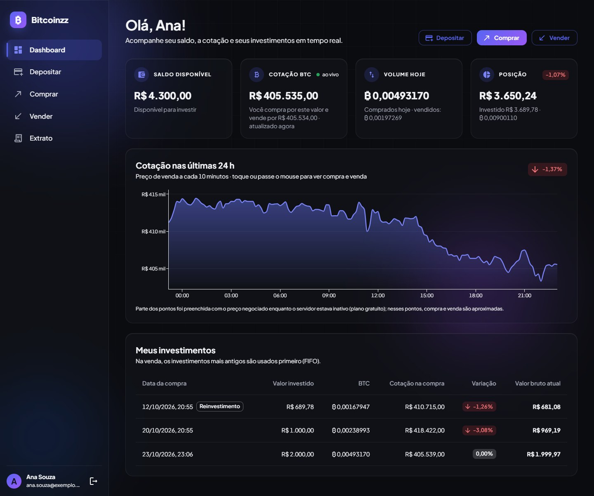
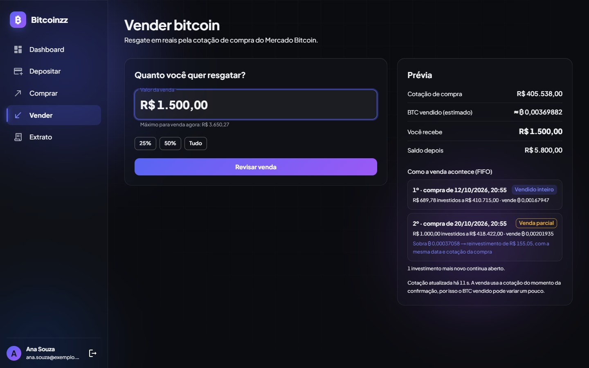
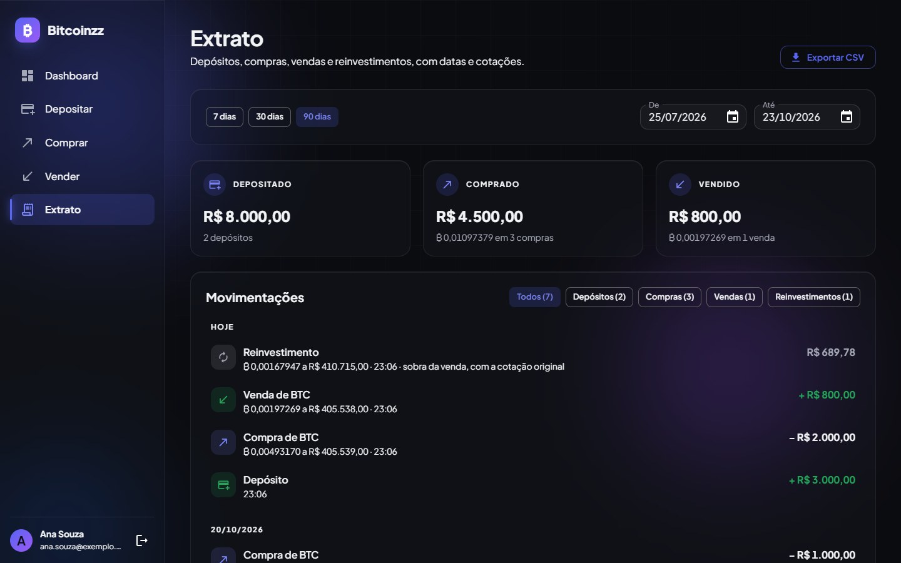
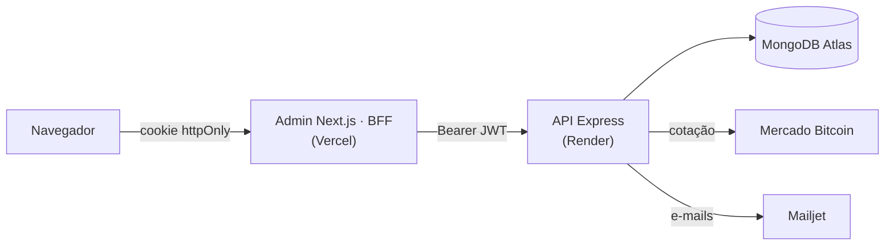

<div align="center">


# Bitcoinzz

**Plataforma simulada de investimento em bitcoin**

Deposite reais (sem dinheiro de verdade), compre e venda BTC pela cotação real do Mercado Bitcoin e acompanhe tudo num painel administrativo.

[](https://github.com/ton-ayr/Bitcoinzz/actions/workflows/ci.yml)
[](LICENSE)


[**Abrir o admin**](https://bitcoinzz.vercel.app) · [API](https://bitcoinzz-api.onrender.com) · [Swagger](https://bitcoinzz-api.onrender.com/docs) · [Arquitetura](docs/architecture.md) · [Contribuindo](CONTRIBUTING.md)



</div>

> [!NOTE]
> A API usa o plano gratuito do Render: depois de 15 min sem uso ela dorme, e o primeiro acesso leva cerca de 1 min. A tela de login já começa a acordá-la e mostra "Acordando o servidor…".

Construída a partir dos desafios de [backend](https://gist.github.com/caferrari/a25734c6e941f6386e7156aa723f28a8) e [frontend](https://gist.github.com/danieloprado/d65ef5eca695550f953986ea6966a485) da Eduzz, nos dois lados (bônus full-stack): API em **Express + TypeScript** em camadas e admin em **Next.js + Material UI**, com testes, Docker e deploy a custo zero.

**Sumário:** [Funcionalidades](#funcionalidades) · [Telas](#telas) · [Como rodar no Linux](#como-rodar-no-linux) · [Testes e qualidade](#testes-e-qualidade) · [API](#api) · [Regras de negócio](#regras-de-negócio) · [Arquitetura](#arquitetura) · [Segurança](#segurança) · [Deploy](#deploy-custo-zero) · [Documentação](#documentação) · [Licença](#licença)

## Funcionalidades

**API: os 11 itens do desafio de backend**

- Cadastro com e-mail de boas-vindas e login com JWT (8 h); todas as rotas de dados exigem login.
- Depósito em R$, saldo e e-mail de confirmação.
- Cotação de compra e venda do BTC (API v4 do Mercado Bitcoin, cache de 10 s).
- Compra de BTC com o saldo, com e-mail do valor investido e do BTC comprado.
- Posição: data, valor investido, cotação na compra, variação % e valor bruto atual de cada investimento.
- Venda por valor em R$, consumindo os investimentos mais antigos primeiro (FIFO), com reinvestimento da sobra e e-mail.
- Extrato dos últimos 90 dias ou de um intervalo, volume do dia e histórico de 10 em 10 minutos nas últimas 24 h (apagado automaticamente após 90 dias).

**Admin: os 6 itens do desafio de frontend**

- Cadastro e login com validação ao vivo e sessão de 8 h.
- Dashboard: saldo, cotação ao vivo, volume do dia, posição, gráfico de 24 h e tabela de investimentos.
- Depósito e compra com prévia em tempo real e confirmação.
- Venda com prévia do FIFO: o que é vendido inteiro, o que é vendido em parte e o que vira reinvestimento.
- Extrato agrupado por dia, com atalhos de período, calendário, filtro por tipo, totais e exportação em CSV.
- Tema escuro com efeito de vidro, responsivo, acessível pelo teclado e com respeito a "reduzir movimento".

## Telas

<table>
  <tr>
    <td width="50%"></td>
    <td width="50%"></td>
  </tr>
  <tr>
    <td align="center"><b>Venda:</b> prévia do FIFO antes de confirmar</td>
    <td align="center"><b>Extrato:</b> agrupado por dia, com totais, filtros e CSV</td>
  </tr>
</table>

## Como rodar no Linux

### Com Docker (recomendado)

Pré-requisito: [Docker](https://docs.docker.com/engine/install/) com o plugin Compose.

```bash
git clone https://github.com/ton-ayr/Bitcoinzz.git
cd Bitcoinzz
cp .env.example .env
sed -i "s/^JWT_SECRET=.*/JWT_SECRET=$(openssl rand -hex 32)/" .env   # gera o segredo do login
docker compose up --build
```

| O quê | Onde |
|---|---|
| Admin | http://localhost:3000 (crie uma conta e use) |
| API e Swagger | http://localhost:3333/docs |
| E-mails | No log da API: `docker compose logs api`. Para enviar de verdade, preencha as chaves da Mailjet no `.env` |
| Parar | `docker compose down` (os dados ficam guardados; `docker compose down -v` apaga tudo) |

O compose sobe três containers: MongoDB 8 (replica set, necessário para as transações), a API e o admin. As portas ficam presas ao `127.0.0.1`.

### Sem Docker

Pré-requisitos: [Node.js 24+](https://nodejs.org/en/download) (versão em [`.nvmrc`](.nvmrc)) e um MongoDB com replica set, como o [Atlas](https://www.mongodb.com/atlas) gratuito (M0).

```bash
git clone https://github.com/ton-ayr/Bitcoinzz.git
cd Bitcoinzz
```

API, num terminal aberto na raiz do projeto:

```bash
cd backend
cp .env.example .env   # preencha MONGODB_URI e JWT_SECRET (openssl rand -hex 32)
npm ci
npm run dev            # http://localhost:3333
```

Admin, em outro terminal, também na raiz do projeto:

```bash
cd frontend
cp .env.example .env.local   # API_URL=http://localhost:3333
npm ci
npm run dev                  # http://localhost:3000
```

### Variáveis de ambiente

| Onde | Variável | Obrigatória | Para quê |
|---|---|---|---|
| API | `MONGODB_URI` | sim | Conexão com o MongoDB (precisa ser replica set) |
| API | `JWT_SECRET` | sim | Assina os logins; mínimo de 32 caracteres |
| API | `JWT_EXPIRES_IN` | não (`8h`) | Duração da sessão |
| API | `PORT` | não (`3333`) | Porta da API |
| API | `CORS_ORIGIN` | não (`http://localhost:3000`) | Origens liberadas no CORS, separadas por vírgula |
| API | `MAILJET_API_KEY`, `MAILJET_SECRET_KEY`, `MAIL_FROM_EMAIL`, `MAIL_FROM_NAME` | não | E-mail real pela Mailjet (as três primeiras juntas); sem elas, os e-mails vão para o log |
| API | `APP_URL` | não | Endereço do admin, usado no botão "Acessar o Bitcoinzz" dos e-mails; sem ela, o botão não aparece |
| API | `QUOTE_API_URL`, `QUOTE_CACHE_TTL_SECONDS` | não | API do Mercado Bitcoin e tempo de cache da cotação |
| API | `LOG_LEVEL` | não (`info`) | Nível do log (`debug`, `warn`...) |
| Admin | `API_URL` | sim | Endereço da API, usado só no servidor do Next |

Os modelos completos, com instruções, estão em [`backend/.env.example`](backend/.env.example), [`frontend/.env.example`](frontend/.env.example) e [`.env.example`](.env.example) (Docker).

## Testes e qualidade

Na raiz do projeto:

```bash
npm --prefix backend test      # 234 testes: unitários + integração com MongoDB em memória
npm --prefix frontend test     # 164 testes: lógica e telas (Testing Library)

npm --prefix backend run lint && npm --prefix backend run typecheck
npm --prefix frontend run lint && npm --prefix frontend run typecheck
```

- Os testes da API não precisam de banco: sobem um MongoDB em memória (o primeiro uso baixa o binário).
- O [CI](.github/workflows/ci.yml) roda lint, tipos, testes e build da API e do admin a cada push e pull request. O Render só publica a API depois que ele passa.

## API

| Método | Rota | Descrição |
|---|---|---|
| POST | `/account` | Cadastro (nome, e-mail, senha) + e-mail de boas-vindas |
| POST | `/login` | Login; devolve o token JWT |
| GET | `/account` | Perfil do usuário logado |
| POST | `/account/deposit` | Depósito em R$ + e-mail |
| GET | `/account/balance` | Saldo em R$ |
| GET | `/btc/price` | Cotação de compra e venda |
| POST | `/btc/purchase` | Compra em R$ + e-mail |
| GET | `/btc` | Posição dos investimentos |
| POST | `/btc/sell` | Venda em R$ (FIFO, com reinvestimento) + e-mail |
| GET | `/extract` | Extrato (`?from=AAAA-MM-DD&to=AAAA-MM-DD`; padrão: 90 dias) |
| GET | `/volume` | BTC comprado e vendido hoje na plataforma |
| GET | `/history` | Cotações de 10 em 10 minutos nas últimas 24 h |
| GET | `/health` | Status da API e do banco |

Os erros seguem sempre o formato `{ statusCode, message, details? }`.

- **Swagger:** abra `/docs` (ex.: http://localhost:3333/docs), faça login em `POST /login`, copie o `token`, clique em **Authorize** e teste as rotas pelo navegador.
- **Postman:** importe a [coleção oficial do desafio](https://cdn.eduzzcdn.com/files/desafio-postman.json) e troque a variável `apiUrl` para `http://localhost:3333`. Rode **Create Account** e depois **Login** com o mesmo e-mail e senha (a coleção vem com `"..."`): o Login guarda o token sozinho, e as demais rotas já o usam.
- A cotação vem da [API v4 do Mercado Bitcoin](https://api.mercadobitcoin.net/api/v4/docs), a versão documentada hoje (a URL v3 do enunciado virou legado).

## Regras de negócio

Interpretações dos pontos que o desafio deixa em aberto:

1. **Cotações:** a compra usa a cotação de **venda** do mercado (como o desafio pede); a venda usa a de **compra**.
2. **Venda por valor em R$**, como no `POST /btc/sell { amount }` da coleção Postman. Os investimentos são vendidos do mais antigo para o mais novo (FIFO); pedir mais do que a posição vale é recusado.
3. **Venda parcial:** o investimento atingido é encerrado, e o BTC que sobra vira um **reinvestimento** com a mesma cotação e a mesma data do original. O extrato registra a venda e o reinvestimento; nenhum BTC é criado ou perdido.
   > Exemplo: o investimento A tem 0,002 BTC comprados a R$ 400.000 (R$ 800). Com a cotação de compra em R$ 500.000, A vale R$ 1.000. Ao vender R$ 600, saem 0,0012 BTC, A é encerrado e nasce o reinvestimento B com 0,0008 BTC a R$ 400.000 (R$ 320).
4. **Valor atual e variação %** usam a cotação de compra atual (quanto o cliente receberia vendendo agora).
5. **Volume** é o total da plataforma no dia (fuso de São Paulo), sem os reinvestimentos.
6. **Dinheiro em inteiros:** centavos e satoshis, com `BigInt` nas conversões. A compra arredonda o BTC para baixo (o cliente nunca recebe a mais); a venda arredonda os satoshis vendidos para cima (para cobrir o valor pedido).
7. **Limites:** valores com até 2 casas; depósito de até R$ 1.000.000,00; compra que não chega a 1 satoshi é recusada; extrato de no máximo 366 dias.
8. **Histórico:** um job grava a cotação a cada 10 minutos. Quando a API acorda (plano gratuito), as lacunas das últimas 24 h são preenchidas com os candles do Mercado Bitcoin, marcados como aproximados.

## Arquitetura



- **API em camadas:** `routes → controller → service → repository`. Só o repository conhece o Mongoose; os services recebem as dependências pelo construtor (montadas em `container.ts`), o que permite testá-los com fakes.
- **Operações financeiras** (depósito, compra e venda) rodam em transações do MongoDB: saldo, investimentos e extrato mudam juntos ou não mudam.
- **Admin como BFF:** o navegador só fala com o próprio Next (`/api/*`), que guarda o JWT num cookie httpOnly e repassa à API apenas as rotas permitidas. O token nunca fica acessível ao JavaScript da página.

```
backend/    API (src/modules: auth, account, quotes, investments, transactions, history, notifications, docs)
frontend/   Admin Next.js (src/app, src/features, src/components, src/server = BFF)
docs/       arquitetura e imagens do README
```

**Stack:** Node.js 24 · TypeScript · Express 5 · MongoDB/Mongoose · Zod · JWT · bcrypt · pino · node-cron · Mailjet · Swagger · Next.js 16 (App Router, Cache Components) · React 19 · Material UI 9 + MUI X (gráfico e calendário) · TanStack Query · React Hook Form · Motion · Vitest · Testing Library · Docker.

Componentes, modelo de dados, fluxos, decisões e integrações em detalhe: [docs/architecture.md](docs/architecture.md).

## Segurança

- Senhas com bcrypt; login com mensagem genérica (não revela se o e-mail existe) e limite de tentativas por e-mail.
- JWT em cookie httpOnly, `Secure` (em produção) e `SameSite=Lax`, com checagem de origem nos POST (CSRF).
- Toda entrada validada com Zod; helmet, rate limit e limite de tamanho no corpo das requisições.
- Segredos só em variáveis de ambiente (nunca no git nem nas imagens Docker).

## Deploy (custo zero)

| Parte | Serviço | Plano |
|---|---|---|
| Admin | Vercel | Hobby (grátis, uso não comercial) |
| API | Render | Free (dorme após 15 min sem uso) |
| Banco | MongoDB Atlas | M0 (grátis, 0,5 GB) |
| E-mail | Mailjet | Free (6.000 e-mails/mês, 200/dia) |

**Configuração:**

- **API (Render):** criada pelo [`render.yaml`](render.yaml) (New → Blueprint). O `JWT_SECRET` é gerado pelo Render e a `APP_URL` vem fixa no arquivo; `MONGODB_URI`, `MAILJET_API_KEY`, `MAILJET_SECRET_KEY` e `MAIL_FROM_EMAIL` são preenchidas no painel. O deploy só acontece com mudanças em `backend/`, no `render.yaml` ou no `.nvmrc`, e com o CI verde.
- **Banco (Atlas):** em Network Access, liberar só as faixas de IP de saída do Render (serviço → Connect → Outbound). Se o Render mudar as faixas, a API perde a conexão com o banco até a lista ser atualizada.
- **Admin (Vercel):** Root Directory `frontend` e a variável `API_URL` com a URL do Render (com https e sem barra no final).
- **E-mail (Mailjet):** remetente validado e as chaves da API. O envio é por HTTP porque o plano free do Render bloqueia as portas de SMTP.

**Avisos do plano gratuito:**

- O primeiro acesso depois de um tempo parado leva cerca de 1 min (a API acorda).
- O Atlas M0 pausa após 30 dias sem uso; basta retomar o cluster no painel do Atlas.
- Sem domínio próprio, os e-mails podem cair no **spam**.

## Documentação

| Documento | Conteúdo |
|---|---|
| [docs/architecture.md](docs/architecture.md) | Componentes, dados, fluxos, segurança, decisões e integrações externas |
| [CONTRIBUTING.md](CONTRIBUTING.md) | Ambiente, convenções, testes, commits e manutenção da documentação |
| [backend/docs/openapi.yaml](backend/docs/openapi.yaml) | Contrato da API (o Swagger servido em `/docs`) |

## Licença

Distribuído sob a licença [MIT](LICENSE): pode ser usado, copiado e modificado, desde que o aviso de copyright seja mantido.
